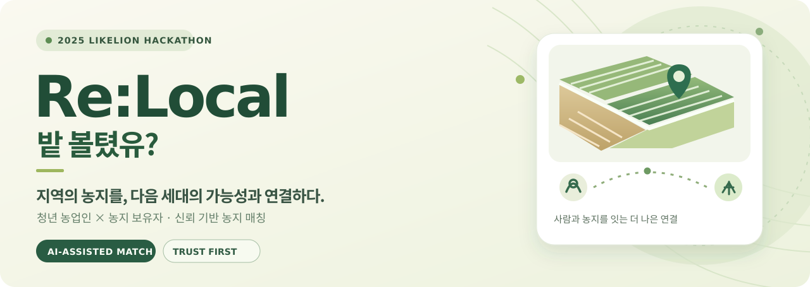
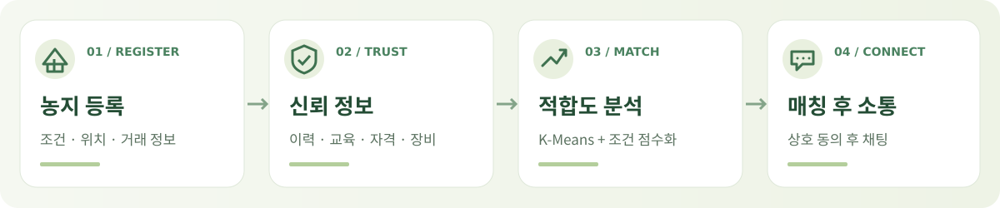

  

  <strong>지역의 자원을 다시 연결하다 · Reconnecting local potential</strong>

  <a href="https://github.com/LikeLionSCH-Hackathon-ReLocal/farmland-matching"><strong>프로젝트 소개</strong></a> ·
  <a href="https://www.figma.com/design/y0GsKpGun5i5Ci2gs1R6Gt/%EB%86%8D%EC%9E%A5?node-id=0-1"><strong>Figma 디자인</strong></a> ·
  <a href="./README.en.md">English</a>

---

## 🌱 Re:Local, 밭 볼텼유?

**밭 볼텼유?**는 농지 보유자와 청년 농업인을 **데이터와 신뢰를 기준으로 연결**하는 농지 매칭 플랫폼 프로젝트입니다.

2025 멋쟁이사자처럼 해커톤에서 시작했습니다. 해커톤의 주제인 *AI로 학교 주변 상권 살리기*를 지역 농업 자원의 활용과 청년 인구 유입이라는 관점으로 재해석했습니다. 농지의 소유·이용 정보를 찾는 어려움과 거래 상대방을 신뢰하기 어려운 문제를 함께 다루고자 했습니다.

> **데이터로 가능성을, 신뢰로 계약을.**  
> 농지는 새로운 시작을 위한 기회가 되고, 청년의 가능성은 지역의 미래가 됩니다.

## 우리가 해결하려는 문제

| 농지 보유자 | 청년 농업인 | Re:Local의 접근 |
| :--- | :--- | :--- |
| 농지를 맡길 상대방의 활동 이력과 신뢰도를 알기 어렵습니다. | 적절한 농지를 찾고 경험과 역량을 증명하기 어렵습니다. | **신뢰 정보**와 **농지 조건**을 정리하고, 양쪽의 적합도를 분석하는 매칭 경험을 설계했습니다. |

## 서비스 흐름

| 핵심 기능 | 설계 및 구현 방향 |
| :--- | :--- |
| **신뢰 기반 프로필** | 교육·자격증·장비·농업 이력 등 정보를 활용해 매칭 판단에 필요한 신뢰 지표 제공 |
| **AI 보조 매칭** | 작물 중심 K-Means 분류와 거리·가격·시설 등 규칙 기반 점수화를 결합한 추천 로직 |
| **사용자 유형별 UX** | 청년을 위한 지도 기반 탐색, 어르신을 위한 큰 버튼과 단계별 입력 UI |
| **매칭 후 소통** | 상호 동의 이후 대화가 가능하도록 설계한 채팅 흐름 |

기능 및 알고리즘 설명은 팀 저장소의 설계·구현 문서에 근거합니다. 실제 서비스 운영 여부나 모델 성능을 보증하는 표현은 아닙니다.

## 프로젝트 구성

| 영역 | 저장소 | 핵심 기술 |
| :--- | :--- | :--- |
| **통합 · 문서** | [farmland-matching](https://github.com/LikeLionSCH-Hackathon-ReLocal/farmland-matching) | 프로젝트 개요, 설계, 문서 및 통합 구성 |
| **Frontend** | [farmland-matching-FE](https://github.com/LikeLionSCH-Hackathon-ReLocal/farmland-matching-FE) | React, Kakao Map API, 반응형 UI |
| **Backend** | [farmland-matching-BE](https://github.com/LikeLionSCH-Hackathon-ReLocal/farmland-matching-BE) | Spring Boot, PostgreSQL, REST API |
| **AI · Matching** | [farmland-matching-AI](https://github.com/LikeLionSCH-Hackathon-ReLocal/farmland-matching-AI) | Python, FastAPI, scikit-learn, K-Means, 규칙 기반 점수화 |

## 만든 사람들

2025 멋쟁이사자처럼 해커톤에서 네 명이 함께 기획하고 구현한 팀 프로젝트입니다.

| 이름 | 담당 영역 |
| :--- | :--- |
| [박성진](https://github.com/ppsssj) | PM · 서비스 기획 · UX/UI · Frontend |
| [이석현](https://github.com/seokhyeon2356) | Backend · API · 서버 로직 |
| [탁유진](https://github.com/tyujin) | Frontend · 디자인 · UI 개선 |
| [서지현](https://github.com/w4vyx) | AI · 매칭 로직 · 데이터 분석 |

## 프로젝트 기록

프로젝트는 **2025년 7월 28일 주제 확정** 이후 기획·개발·통합·시연을 진행했습니다. 최종 발표 및 데모는 **2025년 8월 24–25일** 일정으로 기록되어 있습니다.

  <a href="https://github.com/LikeLionSCH-Hackathon-ReLocal/farmland-matching#readme">프로젝트 전체 README</a> ·
  <a href="https://scented-gemini-52f.notion.site/23d38986b40280acb8c4dc447d47eaa2?source=copy_link">기획 및 회의 기록</a> ·
  <a href="https://www.erdcloud.com/d/y2J9csfyKSwjERDkh">ERD</a>

Re:Local · A 2025 LIKELION SCH Hackathon project · Built with purpose, designed for connection.

